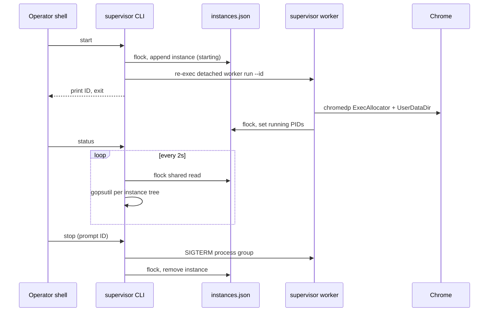

# Implementation Plan: Supervisor CLI (start, status, stop)

**Branch**: `001-supervisor-cli` | **Date**: 2026-11-09 | **Spec**: [spec.md](./spec.md)

**Input**: Feature specification from `specs/001-supervisor-cli/spec.md`  
**User planning constraints**: Go 1.27.1, `chromedp`, `cobra`, detached re-exec workers, JSON registry with file lock, `gopsutil` for metrics.

## Summary

Build the `supervisor` CLI with three Cobra commands (`start`, `status`, `stop`) that manage concurrent chromedp browser instances. `start` accepts mutually exclusive `--headed` (default when omitted) and `--headless`; both set → usage error, no registry write (FR-001d). Each successful `start` re-executes the same binary as a detached **worker** subprocess that owns one chromedp session (isolated Chrome user-data dir, `about:blank`). Instance metadata lives in a **JSON registry** on disk, updated under an **exclusive file lock** so parallel starts from multiple terminals stay safe. Rows in `starting` show CPU/RAM as `unavailable` until `running` (FR-004b). `status` refreshes every ~2s, reads the registry each cycle (FR-005a), and uses **gopsutil** to aggregate CPU/RAM for each instance's worker PID plus its Chrome process tree. `stop` prompts for an ID; unknown ID and already-stopped both exit `0` with distinct messages (FR-007a/b). Reconciliation prunes stale rows, enforces a **60s** failed-start timeout (FR-013), and terminates split-brain orphans (FR-009a/b).

## Technical Context

**Language/Version**: Go 1.27.1 (`go.mod`, constitution)  
**Primary Dependencies**: `github.com/spf13/cobra`, `github.com/chromedp/chromedp`, `github.com/shirou/gopsutil/v4` (process metrics)  
**Storage**: JSON instance registry file under XDG state dir (e.g. `$XDG_STATE_HOME/supervisor/instances.json`); per-instance Chrome profiles under `$XDG_DATA_HOME/supervisor/profiles/<id>/`  
**Testing**: `go test ./...`; integration tests with headless Chrome / chromedp; default suite avoids live casino sites (constitution)  
**Target Platform**: **Linux and WSL2 only** (FR-014); detach via `SysProcAttr` (`Setsid`). macOS and Windows are out of scope for v1  
**Project Type**: CLI binary (`cmd/supervisor`)  
**Performance Goals**: `start` returns within SC-001 (30s); `status` refresh ≥1 update/2s for 10 instances (SC-002); registry RMW under lock &lt;100ms typical  
**Constraints**: No v1 instance cap (FR-011); parallel `start` without global serialization (FR-012); secrets not in repo  
**Scale/Scope**: v1 — three commands, blank page only, interactive `stop` prompt; hidden `worker` subcommand for re-exec only

## Constitution Check

*GATE: Must pass before Phase 0 research. Re-check after Phase 1 design.*

| Principle | Status | Notes |
|-----------|--------|-------|
| I. Spec Before Implementation | Pass | Spec `001-supervisor-cli` + clarifications drive this plan |
| II. CLI as Operator Interface | Pass | All behavior via `supervisor` Cobra commands |
| III. Multiple Browser Instances (chromedp) | Pass | One worker + isolated profile per instance |
| IV. Supervisor Owns the Run | Pass | Workers are lifecycle children; `stop` tears down worker + Chrome |
| V. Named Casinos and Games Only | Pass (scoped) | FR-010: blank page only; no game/casino start in this slice — future spec extends |

**Post–Phase 1 re-check**: Pass. Design does not introduce non-CLI control planes or shared browser profiles.

## Project Structure

### Documentation (this feature)

```text
specs/001-supervisor-cli/
├── plan.md
├── research.md
├── data-model.md
├── quickstart.md
├── contracts/
│   ├── cli.md
│   └── registry-schema.json
└── tasks.md             # /speckit-tasks (not created here)
```

### Source Code (repository root)

```text
cmd/
└── supervisor/
    └── main.go                 # Cobra root; dispatches start|status|stop|worker

internal/
├── cli/
│   ├── root.go
│   ├── start.go
│   ├── status.go
│   └── stop.go
├── registry/
│   ├── registry.go             # JSON load/save, flock
│   └── paths.go                # XDG paths
├── worker/
│   └── run.go                  # chromedp owner loop (worker subcommand)
├── browser/
│   └── chromedp.go             # allocator options, about:blank
├── metrics/
│   └── gopsutil.go             # tree CPU/RAM aggregate
└── instance/
    └── id.go                   # ID generation

tests/
├── integration/
│   ├── start_status_stop_test.go
│   └── registry_concurrent_test.go
└── unit/
    ├── registry_test.go
    └── metrics_test.go
```

**Structure Decision**: Single Go module `github.com/cloudpayout/supervisor` with `cmd/supervisor` entrypoint and `internal/*` packages. Hidden `supervisor worker run` is not documented in operator quickstart but is specified in contracts for implementers.

## Architecture

### Process model



### Registry locking

- **Exclusive lock** (`LOCK_EX`) for create, update, delete, and reconciliation writes.
- **Shared lock** (`LOCK_SH`) optional for `status` read-only passes (if writer starvation is acceptable); otherwise short exclusive read is acceptable for v1.
- Lock granularity: single lock file adjacent to registry (e.g. `instances.lock`) or flock directly on `instances.json` FD.
- **Parallel `start`**: hold exclusive lock only for ID allocation + append; release before spawning worker; worker re-acquires to publish PIDs (FR-012).

### `start` failure vs `starting` (FR-011)

1. **Preflight** (no registry write): validate flags, resolve Chrome/discovery (e.g. `CHROME_PATH` / chromedp default), create `profile_dir`; any error → non-zero exit, no stdout ID.
2. **Under flock**: allocate `id`, append `starting` record.
3. **Detached worker**: `exec.Start` worker; if **Start fails** → re-lock, **remove** the `starting` row (and profile dir if empty), non-zero exit, **no** stdout ID.
4. **Success path**: print ID, exit `0` (FR-001a); row remains `starting` until worker sets `running`.
5. **Worker Chrome failure** after parent exited: worker removes registry row and exits; reconcile/60s timeout is backstop (not a substitute for worker cleanup).

### Worker (detached re-exec)

- Parent: `exec.Command(os.Args[0], "worker", "run", "--id", id)` with `Stdout`/`Stderr` redirected to log file under state dir, `SysProcAttr`: `Setsid: true`, parent does not wait after successful `Start` (FR-001a/b).
- Child: run chromedp with dedicated `UserDataDir`, navigate `about:blank`, block until SIGTERM or browser disconnect; on exit, flock + remove instance or mark `stopped` and reconcile orphans.
- Store `owner_pid` = worker PID; after Chrome launch store `browser_pid` (root browser process from chromedp/allocator) for metrics walking.

### Metrics (`status`)

- For each `running` instance: collect PIDs = `{owner_pid} ∪ descendants(browser_pid)` via `gopsutil` `Children` recursion.
- For `starting` instances: display CPU/RAM as `unavailable` (FR-004b); still list ID and state.
- Sum `CPUPercent()` and RSS memory across set when `running`; show `unavailable` if process gone → trigger registry reconciliation (FR-004a, edge cases).
- Each refresh: locked registry read; list matches adds/removals from concurrent `start`/`stop` within one cycle (FR-005a).

### Reconciliation

- **Failed start**: remove registry row if `starting` for > **60s** from `created_at`; tear down owner/Chrome where possible (FR-013).
- **Owner dead, Chrome alive**: remove row; terminate orphan Chrome tree for that profile (FR-009a).
- **Chrome dead, owner alive**: remove row; terminate owner (FR-009b).
- Runs on `status` refresh, `stop`, and worker exit paths.

### Stop

- Prompt instance ID (`fmt.Scanln` or similar); empty/cancel → exit `0`, no termination (FR-006a).
- On non-empty ID: **run shared reconciliation** under flock (`reconcile.go`: 60s `starting` timeout, FR-009a/b) **before** ID lookup, matching `status` refresh and worker exit paths.
- Unknown ID (no registry row after reconcile) → exit `0`, not-found message (FR-007b).
- Row exists but processes gone → exit `0`, already-stopped message, prune row (FR-007a).
- Live stop: lookup under lock; `SIGTERM` to worker process **group** (kill Chrome subtree); fallback `SIGKILL` on timeout; remove registry entry (FR-006–FR-009).

### `start` flags

- `--headed` and `--headless` are mutually exclusive booleans; default **headed** when neither is passed (FR-001d).
- Both flags on one invocation: Cobra usage error (exit `2`); no instance registered.
- Pass chosen mode to worker (chromedp `Headless` allocator option).

## Complexity Tracking

> No constitution violations requiring justification.

| Violation | Why Needed | Simpler Alternative Rejected Because |
|-----------|------------|-------------------------------------|
| — | — | — |

## Phase Artifacts

| Phase | Output | Path |
|-------|--------|------|
| 0 | Research decisions | [research.md](./research.md) |
| 1 | Data model | [data-model.md](./data-model.md) |
| 1 | CLI + registry contracts | [contracts/](./contracts/) |
| 1 | Validation guide | [quickstart.md](./quickstart.md) |
