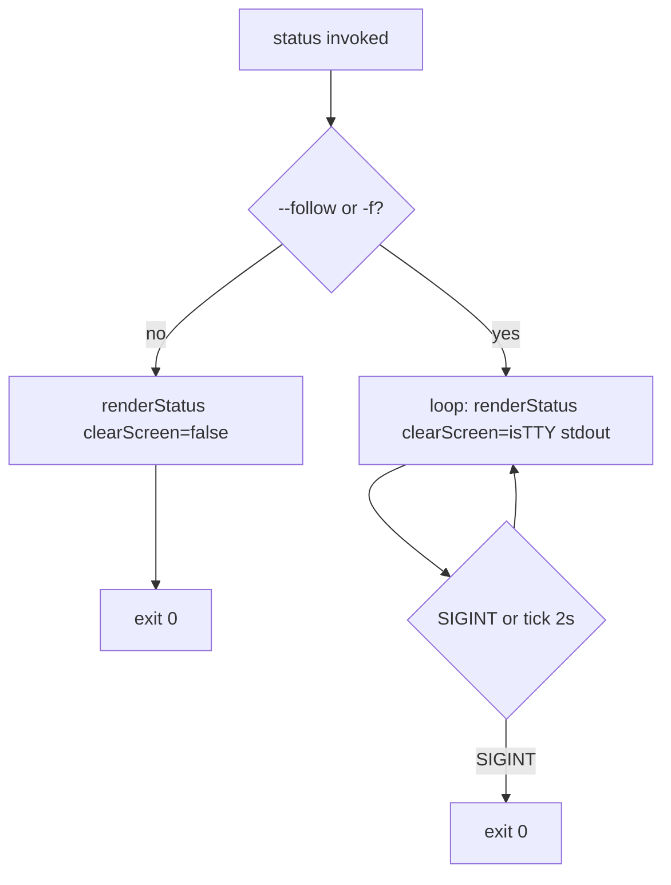

# Implementation Plan: Status and Stop CLI Behavior

**Branch**: `002-status-stop-cli` | **Date**: 2026-11-09 | **Spec**: [spec.md](./spec.md)

**Input**: Feature specification from `specs/002-status-stop-cli/spec.md`

## Summary

Change default `supervisor status` to a **one-shot** snapshot (reconcile + print table or empty message, exit `0`) and move the today’s ~2s refresh loop behind `--follow` / `-f`, keeping TTY full-screen clear only in follow mode (FR-001, FR-002, clarification 2026-11-09). Change `supervisor stop` to require a **positional instance ID** (`cobra.ExactArgs(1)`), remove stdin prompting and “stop aborted” paths (FR-004–FR-006), and preserve reconciliation and not-found / already-stopped semantics (FR-007). Touch `internal/cli/status.go`, `internal/cli/stop.go`, operator help strings, [cli contract](./contracts/cli.md), and integration tests under `tests/integration/` (FR-009). No registry schema or `start` / `worker` changes.

## Technical Context

**Language/Version**: Go 1.27.1 (`go.mod`, constitution)  
**Primary Dependencies**: `github.com/spf13/cobra` (flags, args validation, usage exit `2`)  
**Storage**: Unchanged — JSON registry via `internal/registry` (001)  
**Testing**: `go test ./...`; update `tests/integration/status_refresh_test.go`, `stop_lifecycle_test.go`, `start_worker_test.go` helper `stopID`, and any test that assumes default status loops or stop stdin  
**Target Platform**: Linux and WSL2 (unchanged)  
**Project Type**: CLI binary `cmd/supervisor`  
**Performance Goals**: One-shot status meets SC-001 (&lt;5s); follow mode meets SC-002 (≥1 refresh / 2s)  
**Constraints**: Minimize diff — refactor `renderStatus` rather than duplicating table logic; breaking CLI change for stop is intentional per spec assumptions  
**Scale/Scope**: Two commands only; ~200 LOC delta including tests

## Constitution Check

*GATE: Must pass before Phase 0 research. Re-check after Phase 1 design.*

| Principle | Status | Notes |
|-----------|--------|-------|
| I. Spec Before Implementation | Pass | Spec `002-status-stop-cli` + clarifications drive this plan |
| II. CLI as Operator Interface | Pass | Behavior remains on `status` and `stop` only |
| III. Multiple Browser Instances | Pass | No change to chromedp / worker model |
| IV. Supervisor Owns the Run | Pass | Stop still terminates worker + Chrome via existing `proc` paths |
| V. Named Casinos and Games Only | Pass | Out of scope |

**Post–Phase 1 re-check**: Pass. Contracts document operator deltas only; registry unchanged.

## Project Structure

### Documentation (this feature)

```text
specs/002-status-stop-cli/
├── plan.md
├── research.md
├── data-model.md
├── quickstart.md
├── contracts/
│   └── cli.md
└── tasks.md             # /speckit-tasks (not created here)
```

### Source Code (repository root)

```text
internal/cli/
├── status.go     # --follow / -f; one-shot vs loop; renderStatus(clearScreen)
└── stop.go       # Args: id; remove stdin prompt

tests/integration/
├── status_refresh_test.go   # use status -f for SIGINT loop
├── stop_lifecycle_test.go   # stop <id>; missing-arg usage error
├── start_worker_test.go     # stopID helper: stop + id arg
└── ...                        # audit grep for Command(bin, "stop") without args
```

**Structure Decision**: Continue single-module layout from 001; no new packages.

## Design

### `status` control flow



- Reuse existing `renderStatus` + `registry.Apply` path; add `clearScreen bool` so FR-001 never emits `\033[H\033[2J` on one-shot (FR-003).
- Follow branch: extract current `runStatus` loop; register `BoolP("follow", "f", false, ...)` on command.

### `stop` control flow

- `Use: "stop <instance-id>"`, `Args: cobra.ExactArgs(1)` — zero or multiple args → Cobra usage, exit `2` (FR-006).
- In `RunE`: `id := strings.TrimSpace(args[0])`; if empty, return `fmt.Errorf` or `errors.New` so Cobra surfaces usage (whitespace-only ID).
- Delete `bufio` stdin read and “stop aborted” branches; keep `store.Update` + `registry.Apply` + `proc.Terminate` body unchanged (FR-007).

### Exit codes (delta)

| Change | Code |
|--------|------|
| `stop` with no ID (was abort `0`) | `2` usage |
| `stop` with extra args | `2` usage |
| All other stop outcomes | Unchanged from 001 contract |

Remove exit `0` meaning “stop abort” from operator docs (001 FR-006a superseded for 002).

## Phase 0 / Phase 1 Artifacts

| Artifact | Path |
|----------|------|
| Research decisions | [research.md](./research.md) |
| Data model (CLI view) | [data-model.md](./data-model.md) |
| CLI contract v2 | [contracts/cli.md](./contracts/cli.md) |
| Validation guide | [quickstart.md](./quickstart.md) |

## Complexity Tracking

> No constitution violations — table omitted.
