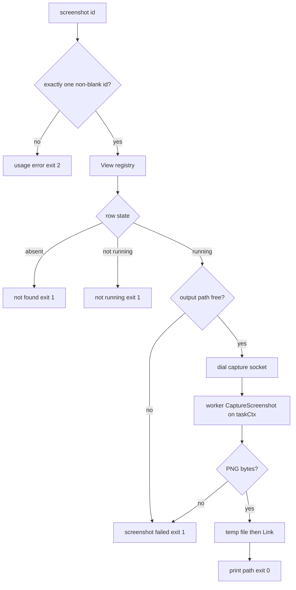

# Implementation Plan: Screenshot CLI

**Branch**: `feature/screenshot-command` | **Feature directory**: `specs/003-screenshot-cli` | **Date**: 2026-11-15 | **Spec**: [spec.md](./spec.md)

**Input**: Feature specification from `specs/003-screenshot-cli/spec.md`

## Summary

Add `supervisor screenshot <instance-id>` to save one PNG of the page a running instance is showing. The detached worker that already owns that chromedp tab runs `chromedp.CaptureScreenshot` on its existing context (FR-001, FR-005, FR-008, FR-009). The CLI reaches that worker through a Unix socket derived from the instance ID, then publishes the bytes with `os.Link` so an existing file is never replaced (FR-006, FR-007, FR-011). `--output` / `-o` accepts a relative or absolute path and is printed unchanged on success (User Story 3). Missing arguments are a usage error (exit 2). An unknown ID, a non-running row, and a failed capture are operational errors (exit 1) and create no image (FR-003, FR-010). The command reads the registry with `View` only and finishes within 15 seconds without cancelling the browser context (FR-012). No registry schema change. `start`, `status`, and `stop` stay as they are.

## Technical Context

**Language/Version**: Go 1.27.1 (`go.mod`, constitution)

**Primary Dependencies**: `github.com/chromedp/chromedp` v0.23.0 (`CaptureScreenshot`, existing worker context); `github.com/spf13/cobra` v1.10.2 (args and `--output` / `-o`)

**Storage**: Unchanged JSON registry (`internal/registry`, schema version 1). The PNG is an operator file, not a registry record. The capture socket is a filesystem endpoint under the XDG state dir, not a new stored field.

**Testing**: `go test ./...`. Unit tests for path selection, no-overwrite publish, and a failed publish that leaves no final PNG, all without Chrome. Integration tests under `tests/integration/` with headless Chrome, skipped when Chrome is absent (`requireChrome`): one instance, two instances, and `--output`. A visible window is a manual quickstart check, not a default-test gate.

**Target Platform**: Linux and WSL2 (constitution, spec edge case)

**Project Type**: CLI binary `cmd/supervisor`

**Performance Goals**: One capture returns or fails within 15 seconds (FR-012, SC-001). Worker-side chromedp call is limited to 10 seconds so disk publish still fits in the command budget.

**Constraints**: Do not open a second tab, do not change Chrome allocator flags, do not bump `schema_version`, do not reconcile other instances, do not overwrite an existing output file, do not leave a partial PNG at the final path.

**Scale/Scope**: One new operator command and one internal socket per running instance. One image per invocation. No gallery, video, or multi-instance capture.

## Constitution Check

*GATE: Must pass before Phase 0 research. Re-check after Phase 1 design.*

| Principle | Status | Notes |
|-----------|--------|-------|
| I. Spec Before Implementation | Pass | Spec `003-screenshot-cli` drives this plan |
| II. CLI as the Operator Interface | Pass | Capture is a new `screenshot` command; no other operator surface |
| III. Multiple Browser Instances | Pass | Capture uses that instance's own chromedp tab. No shared browser, no new debugging port |
| IV. Supervisor Owns the Run | Pass | The worker still owns the session. Screenshot does not stop, navigate, or hand the session to another process |
| V. Named Casinos and Games Only | Pass | No casino or game selection |

Technical constraints: module path, Go 1.27.1, and chromedp stay as ratified. Screenshot bytes are runtime output and are not committed. Default tests do not hit a live casino site.

**Post–Phase 1 re-check**: Pass. [research.md](./research.md) keeps capture on the worker context. [data-model.md](./data-model.md) adds no registry fields. [contracts/cli.md](./contracts/cli.md) is the operator delta. [contracts/capture-socket.md](./contracts/capture-socket.md) is internal only.

## Project Structure

### Documentation (this feature)

```text
specs/003-screenshot-cli/
├── plan.md
├── research.md
├── data-model.md
├── quickstart.md
├── contracts/
│   ├── cli.md
│   └── capture-socket.md
└── tasks.md
```

### Source Code (repository root)

```text
internal/cli/
├── root.go            # register screenshot
└── screenshot.go      # args, lookup, dial, publish

internal/registry/
└── paths.go           # Layout.CaptureSocket(id)

internal/worker/
├── run.go             # start and stop the listener after state=running
└── capture.go         # unix socket + chromedp.CaptureScreenshot

tests/unit/
├── screenshot_test.go          # socket contract
├── screenshot_output_test.go   # --output path rules
└── screenshot_publish_test.go  # failed publish leaves no final PNG

tests/integration/
├── screenshot_test.go          # default capture and two headless instances
├── screenshot_refuse_test.go   # usage, not found, not running
└── screenshot_output_test.go   # -o relative and absolute
```

**Structure Decision**: Keep the single-module layout from 001. The worker gains a listener; the CLI gains one command. No new module and no registry schema file change.

## Design

### Command flow



### Worker

- v1 has one page per instance: the worker tab created at start. `CaptureScreenshot` uses that tab. Another tab is out of scope.
- Listen only after the row is updated to `running` in `internal/worker/run.go`. A `starting` instance has no socket; the CLI still reports "not running" from the registry row. A missing row, including after stop removes it, is "not found".
- Accept loop in a goroutine. Mutex around `chromedp.Run(childCtx, chromedp.CaptureScreenshot())` so two captures of one tab cannot interleave.
- `childCtx` is `context.WithTimeout(taskCtx, 10*time.Second)`. Do not call `chromedp.Navigate`, viewport emulation, or `taskCancel` from this path.
- On `taskCtx` done, close the listener and remove the socket file before the existing `remove(reg, id)`.

### Output path

- Flag absent: `screenshot-<id>-<YYYYMMDD-HHMMSS>.png` in the working directory, local time, then `-2`, `-3`, … on collision. Stdout prints that relative name.
- `--output` / `-o`: relative paths join the working directory; absolute paths stay absolute. Stdout prints the trimmed flag value. Blank value is a usage error.
- Reject an existing file, a directory, or a missing parent before dialing the worker.
- Publish with a same-directory temporary file and `os.Link`. Remove the temporary file on every failure path.

### Exit codes (delta)

| Outcome | Code | Stream |
|---------|------|--------|
| Image published | 0 | Path only, stdout |
| Missing, extra, or blank ID; blank `--output`; bad flags | 2 | stderr, usage |
| Not found, not running, capture or write failure | 1 | stderr |

Not-found is exit 1, unlike `stop`. See [research R3](./research.md).

## Phase 0 / Phase 1 Artifacts

| Artifact | Path |
|----------|------|
| Research decisions | [research.md](./research.md) |
| Data model | [data-model.md](./data-model.md) |
| Operator contract | [contracts/cli.md](./contracts/cli.md) |
| Worker socket contract | [contracts/capture-socket.md](./contracts/capture-socket.md) |
| Validation guide | [quickstart.md](./quickstart.md) |

## Complexity Tracking

No constitution violations. Table omitted.
