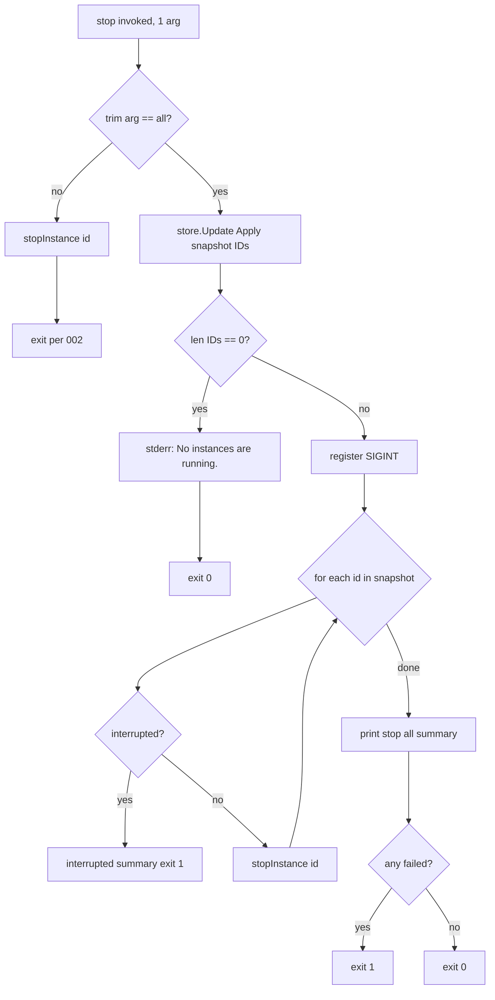

# Implementation Plan: Stop All Instances Command

**Branch**: `011-stop-all-command` | **Date**: 2026-11-22 | **Spec**: [spec.md](./spec.md)

**Input**: Feature specification from `specs/011-stop-all-command/spec.md`

## Summary

Add **`supervisor stop all`**: when the sole positional argument is the reserved token `all`, snapshot instance IDs after one reconciliation, stop each with the same logic as `stop <id>`, print per-ID stderr lines plus one summary, and aggregate exit code on failures or SIGINT. Refactor `internal/cli/stop.go` to share per-instance stop code; update help and integration tests. No registry schema, `start`, or `worker` changes.

## Technical Context

**Language/Version**: Go 1.27.1 (`go.mod`, constitution)

**Primary Dependencies**: `github.com/spf13/cobra`; stdlib `fmt`, `os`, `os/signal`, `strings`, `syscall`, `time`

**Storage**: JSON registry via `internal/registry` (unchanged)

**Testing**: `go test ./...`; add `tests/integration/stop_all_test.go`; extend stop help assertions; quickstart grep updates (FR-011)

**Target Platform**: Linux and WSL2 only

**Project Type**: CLI (`cmd/supervisor`)

**Performance Goals**: SC-001 five instances within 60s; SC-002 empty bulk under 3s

**Constraints**: Single-ID stop behavior frozen (002 contract); reserved `all` case-sensitive; default tests without live casino

**Scale/Scope**: ~120–180 LOC in `stop.go` including refactor; one integration test file

## Constitution Check

*GATE: Must pass before Phase 0 research. Re-check after Phase 1 design.*

| Principle | Status | Notes |
|-----------|--------|-------|
| I. Spec Before Implementation | Pass | Spec `011-stop-all-command` drives plan |
| II. CLI as Operator Interface | Pass | Bulk teardown on `stop` |
| III. Multiple Browser Instances | Pass | Stops each isolated instance via existing `proc` paths |
| IV. Supervisor Owns the Run | Pass | Terminates worker + Chrome per instance |
| V. Named Casinos and Games Only | Pass | No catalog change |
| Technical: Go, chromedp, secrets | Pass | No new secrets |
| Delivery: CLI stop tests | Pass | Integration tests in research R7 |

**Gate result**: Pass.

**Post–Phase 1 re-check**: Pass. Contract v11 documents delta only; registry schema unchanged.

## Project Structure

### Documentation (this feature)

```text
specs/011-stop-all-command/
├── plan.md
├── spec.md
├── research.md
├── data-model.md
├── quickstart.md
├── contracts/
│   └── cli.md
└── tasks.md             # /speckit-tasks
```

### Source Code (repository root)

```text
internal/cli/stop.go       # stopAllToken; stopInstance; runStopAll; runStop dispatch; help text
tests/integration/stop_all_test.go
tests/integration/stop_lifecycle_test.go   # unchanged expectations for single ID
specs/001-supervisor-cli/quickstart.md       # FR-011 wording
specs/002-status-stop-cli/quickstart.md      # FR-011 wording
```

**Structure Decision**: Single Go module; bulk logic colocated with stop (no new package).

## Design

### Control flow



### `stop.go` changes

1. Constant `stopAllToken = "all"`.
2. `runStop(id string)`: if `id == stopAllToken` return `runStopAll()`; else delegate to `stopInstance`.
3. `stopInstance(id string)`: extract current `runStop` logic; return typed outcome + `error` for operational failures (research R8, FR-005).
4. `runStopAll()`: snapshot → if empty, stderr `No instances are running.` and return (FR-003) → loop with interrupt → summary → aggregate error.
5. Update `Use` to `stop <instance-id|all>` and `Long`/`Short` per FR-010.

### Outcomes and messaging

See [data-model.md](./data-model.md) and [contracts/cli.md](./contracts/cli.md) for counter rules and exact strings.

### Exit codes

No change to Cobra usage (`2`). Bulk operational failure or interrupt returns `RunE` error → `1`. Successful bulk including empty → `0`.

## Complexity Tracking

No constitution violations requiring justification.

## Phase 0 / Phase 1 Artifacts

| Artifact | Path | Status |
|----------|------|--------|
| Research | [research.md](./research.md) | Complete |
| Data model | [data-model.md](./data-model.md) | Complete |
| CLI contract | [contracts/cli.md](./contracts/cli.md) | Complete |
| Quickstart | [quickstart.md](./quickstart.md) | Complete |

**Next**: `/speckit-tasks` to generate `tasks.md` and implement.