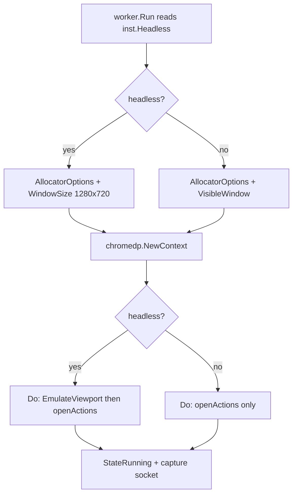

# Implementation Plan: Headless Viewport 1280×720

**Branch**: `012-headless-mode-viewport` | **Date**: 2026-11-22 | **Spec**: [spec.md](./spec.md)

**Input**: Feature specification from `specs/012-headless-mode-viewport/spec.md`

## Summary

Standardize **1280×720** layout for every `--headless` instance: add constants in `internal/browser`, set `WindowSize` in the Chrome allocator when headless, and run `EmulateViewport` as the first worker action before cookies and navigation. Headed starts unchanged. Verify with a new integration test that decodes screenshot PNG bounds. Update `start` help text. No registry schema change.

## Technical Context

**Language/Version**: Go 1.27.1 (`go.mod`, constitution)

**Primary Dependencies**: `github.com/chromedp/chromedp` v0.23 (`EmulateViewport`, `WindowSize`, existing worker/capture path); `github.com/spf13/cobra` (start help only)

**Storage**: JSON registry unchanged; viewport implied by `headless` flag (FR-005)

**Testing**: `go test ./...`; new `tests/integration/headless_viewport_test.go` (PNG 1280×720); optional extend `start_help_test.go` for help string

**Target Platform**: Linux and WSL2 only

**Project Type**: CLI (`cmd/supervisor`)

**Performance Goals**: No new latency budget; one extra CDP call at worker open (negligible vs navigation)

**Constraints**: Do not emulate viewport on screenshot child context (003); do not change headed allocator; no new CLI flags

**Scale/Scope**: ~40–80 LOC across `internal/browser/chromedp.go`, `internal/worker/run.go`, `internal/cli/start.go`; one integration test file

## Constitution Check

*GATE: Must pass before Phase 0 research. Re-check after Phase 1 design.*

| Principle | Status | Notes |
|-----------|--------|-------|
| I. Spec Before Implementation | Pass | Spec `012-headless-mode-viewport` drives plan |
| II. CLI as Operator Interface | Pass | Behavior tied to existing `--headless`; help update only |
| III. Multiple Browser Instances | Pass | Per-instance viewport at allocator + worker open |
| IV. Supervisor Owns the Run | Pass | Worker sets layout before automation scripts |
| V. Named Casinos and Games Only | Pass | No catalog change |
| Technical: Go, chromedp, secrets | Pass | No new secrets |
| Delivery: automated tests | Pass | Integration screenshot dimensions; default tests no live casino |

**Gate result**: Pass.

**Post–Phase 1 re-check**: Pass. No registry fields; contracts document operator-observable deltas only.

## Project Structure

### Documentation (this feature)

```text
specs/012-headless-mode-viewport/
├── plan.md
├── spec.md
├── research.md
├── data-model.md
├── quickstart.md
├── contracts/
│   ├── cli.md
│   └── worker-viewport.md
└── tasks.md             # /speckit-tasks
```

### Source Code (repository root)

```text
internal/browser/chromedp.go    # HeadlessViewportWidth/Height; WindowSize when headless
internal/worker/run.go          # Prepend EmulateViewport before openActions when headless
internal/cli/start.go             # Help / flag text for 1280×720 (FR-007)
tests/integration/headless_viewport_test.go
tests/integration/start_help_test.go   # optional assertion extension
```

**Structure Decision**: Single Go module; viewport policy colocated in `browser` + worker open path (no new package).

## Design

### Control flow (worker open, headless)



### `internal/browser/chromedp.go`

1. Export `HeadlessViewportWidth` = 1280, `HeadlessViewportHeight` = 720.
2. In `AllocatorOptions`, when `headless == true`, append `chromedp.WindowSize(HeadlessViewportWidth, HeadlessViewportHeight)`.

### `internal/worker/run.go`

1. After `headless` is read from registry, build open action list:
   - If headless: `chromedp.EmulateViewport(browser.HeadlessViewportWidth, browser.HeadlessViewportHeight)` then existing `openActions(...)`.
   - Else: unchanged `openActions` only.
2. Keep capture callback unchanged (research R6).

### `internal/cli/start.go`

Update `--headless` flag `Usage` and/or `Long` to mention 1280×720 layout per [contracts/cli.md](./contracts/cli.md).

### Testing

- **Integration**: blank `start --headless` → `screenshot` → `image.DecodeConfig` width/height 1280/720 (research R4).
- **Regression**: existing headed and headless lifecycle tests unchanged except where they assumed smaller PNG size (if any).

## Complexity Tracking

No constitution violations requiring justification.

## Phase 0 / Phase 1 Artifacts

| Artifact | Path | Status |
|----------|------|--------|
| Research | [research.md](./research.md) | Complete |
| Data model | [data-model.md](./data-model.md) | Complete |
| CLI contract | [contracts/cli.md](./contracts/cli.md) | Complete |
| Worker contract | [contracts/worker-viewport.md](./contracts/worker-viewport.md) | Complete |
| Quickstart | [quickstart.md](./quickstart.md) | Complete |

**Next**: `/speckit-tasks` to generate `tasks.md` and implement.