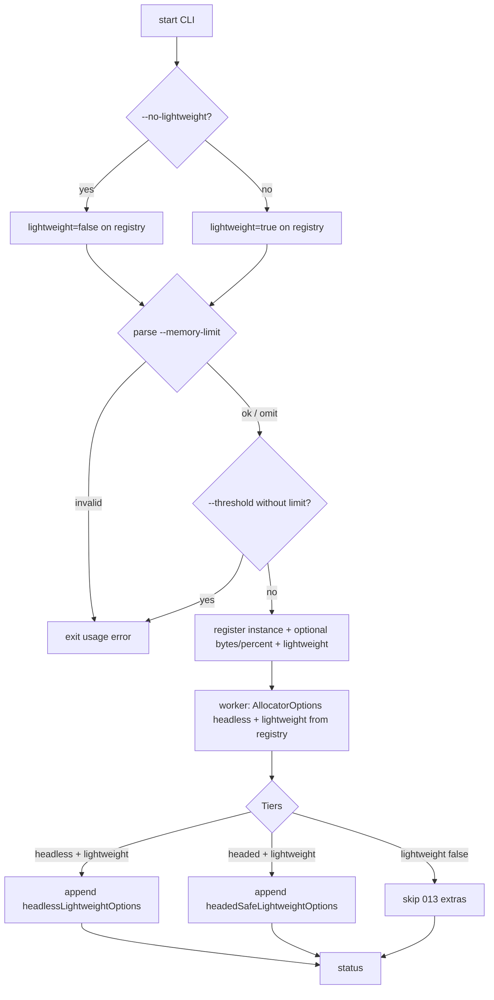
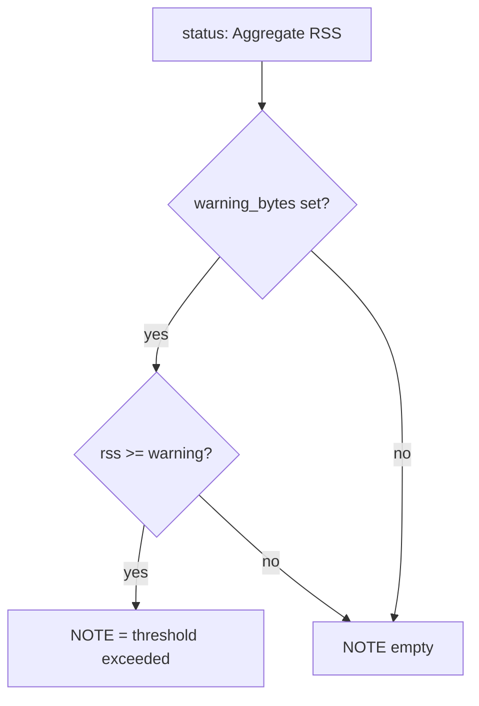

# Implementation Plan: Lightweight Browser Instances

**Branch**: `013-optimizing-browsers` | **Date**: 2026-11-23 | **Spec**: [spec.md](./spec.md)

**Input**: Feature specification from `specs/013-optimizing-browsers/spec.md` + operator Chrome flag recommendations (adopted with guardrails in [research.md](./research.md)).

## Summary

Deliver a **default headless lightweight Chrome profile** to reduce idle **memory (MiB)** without breaking casino guardrails; optional **`--no-lightweight`** to skip all 013 allocator extras (headed or headless); **headed-safe** lightweight tier when headed and lightweight is on; optional **`--memory-limit`** / **`--threshold`** on `start`; extend **`status`** with **NOTE** and **`current MiB/limit MiB`** MEMORY formatting; persist memory policy and **`lightweight`** on registry **schema v2**. Operator-suggested flags are integrated **except** GPU/software-rasterizer disables and the aggressive V8 JS bundle (see [contracts/browser-allocator.md](./contracts/browser-allocator.md)).

## Technical Context

**Language/Version**: Go 1.27.1 (`go.mod`)

**Primary Dependencies**: `chromedp` v0.23, `cobra`, `gopsutil` (existing metrics path)

**Storage**: JSON registry (`instances.json`) + optional `memory_limit_bytes` / `memory_threshold_percent`; **`lightweight`** boolean on each 013 instance row (schema 2)

**Testing**: `go test ./...`; integration tests for memory flags, NOTE, five-headless (SC-005), start-under-warning (FR-016); unit `TestHeadlessLightweightAllocatorFlags` + **`--no-lightweight`** contrast (FR-008, FR-018); headed-safe vs full bundle tests; baseline capture in [research.md](./research.md) Baseline Record (SC-001 manual)

**Target Platform**: Linux and WSL2

**Project Type**: CLI (`cmd/supervisor`)

**Performance Goals**: ≥20% median idle MiB reduction vs documented pre-change baseline on reference host (SC-001); measurement uses default `start --headless` (lightweight **on**), not `--no-lightweight`

**Constraints**: chromedp-only; WebGL/SwiftShader + Spribe overrides preserved; no auto-stop/restart on memory (v1)

**Scale/Scope**: ~450–750 LOC across `internal/browser`, `internal/memlimit` (new), `internal/registry`, `internal/cli/start.go`, `internal/cli/status.go`, worker registry pass-through for `lightweight`; 3–5 integration test files

## Constitution Check

*GATE: Must pass before Phase 0 research. Re-check after Phase 1 design.*

| Principle | Status | Notes |
|-----------|--------|-------|
| I. Spec Before Implementation | Pass | Spec 013 + this plan |
| II. CLI as Operator Interface | Pass | start/status only |
| III. Multiple Browser Instances | Pass | Per-instance RSS + NOTE; per-instance lightweight |
| IV. Supervisor Owns the Run | Pass | Allocator at worker open from registry |
| V. Named Casinos and Games Only | Pass | Guardrails in research R2 |
| Technical: Go, chromedp | Pass | |
| Delivery: tests | Pass | Default suite no live casino |

**Gate result**: Pass.

**Post–Phase 1 re-check**: Pass. Registry schema v2 backward compatible; contracts document CLI deltas including `--no-lightweight`.

## Project Structure

### Documentation (this feature)

```text
specs/013-optimizing-browsers/
├── plan.md
├── spec.md
├── research.md
├── data-model.md
├── quickstart.md
├── contracts/
│   ├── cli.md
│   ├── browser-allocator.md
│   └── registry-schema.json
└── tasks.md             # /speckit-tasks
```

### Source Code (repository root)

```text
internal/browser/chromedp.go       # headlessLightweightOptions(); headedSafeLightweightOptions(); tests
internal/memlimit/parse.go         # ParseLimit("--memory-limit" strings) → bytes
internal/memlimit/format.go        # FormatMiB for status
internal/registry/types.go         # memory + lightweight fields; SchemaVersion = 2 constant
internal/cli/start.go                # flags, parse, persist policy + lightweight
internal/cli/status.go               # NOTE + MEMORY formatting
internal/worker/run.go               # pass lightweight into AllocatorOptions (if not already via registry)
headless-chrome-flags.txt            # regenerate from allocator + research
tests/integration/memory_limit_test.go
tests/integration/status_note_test.go
tests/integration/lightweight_flag_test.go   # FR-018 on/off
# SC-001 median MiB: research.md Baseline Record (manual); not default CI gate
tests/integration/five_headless_starts_test.go  # SC-005
tests/integration/memory_start_under_warning_test.go  # FR-016
tests/unit/memlimit_test.go
internal/browser/chromedp_test.go      # lightweight on/off + headed-safe assertions
```

**Structure Decision**: Single Go module; parsing isolated in `memlimit`; allocator policy stays in `browser`.

## Design

### Lightweight tiers (FR-001, FR-018)

| Mode | `--no-lightweight` | Allocator tier |
|------|--------------------|----------------|
| Headless | omitted | **Full** headless lightweight bundle ([browser-allocator.md](./contracts/browser-allocator.md)) |
| Headless | set | **None** — pre-013 headless extras only (Spribe/WebGL path unchanged) |
| Headed | omitted | **Headed-safe** only (`force-device-scale-factor=1`; no renderer/V8/cache bundle) |
| Headed | set | **None** — legacy headed path for 013 purposes |

Registry row **`lightweight: true|false`** records effective tier: `false` when `--no-lightweight`; `true` when headed-safe or full headless bundle applies. Worker MUST read this at browser open.

### Control flow (start → allocator)



### Control flow (memory policy on status)



### Phase A — Lightweight allocator (P1)

1. Add `headlessLightweightOptions()` and `headedSafeLightweightOptions()` per [browser-allocator.md](./contracts/browser-allocator.md).
2. Extend `AllocatorOptions(profileDir, headless, lightweight bool)` (or equivalent) — append tier after Spribe/casino flags.
3. `--no-lightweight` ⇒ `lightweight == false` ⇒ no 013 slices appended.
4. Update `headless-chrome-flags.txt` to document full bundle vs headed-safe vs opt-out.
5. Record **pre-change baseline** MiB before merging (FR-007); SC-001 uses default headless **with** lightweight.

### Phase B — Registry + start flags (P1)

1. `registry.Instance`: `MemoryLimitBytes`, `MemoryThresholdPercent`, **`Lightweight`** (`omitempty`; write explicit `true`/`false` for new starts in 013).
2. Bump `SchemaVersion` to **2** when any 013 field first written (memory policy and/or explicit lightweight on new rows); reads tolerate v1.
3. `start` flags: `--memory-limit`, `--threshold`, **`--no-lightweight`**; validation per [contracts/cli.md](./contracts/cli.md).
4. Worker registration path MUST pass `lightweight` and `headless` into allocator.

### Phase C — Status columns (P1)

1. Header: add **NOTE**.
2. `formatMemory(inst, snap)` → single-value or `current/limit`.
3. `noteFor(inst, snap)` → `threshold exceeded` or empty.
4. Update integration tests that assert `MEMORY` header (e.g. ten-instances test).

### Phase D — Tests + docs (P2)

1. Unit: `memlimit` parse accept `512M`, `512MiB`, `1G`; reject `512MB`.
2. Unit/integration: default `start --headless` includes full bundle; `start --headless --no-lightweight` excludes it (FR-008); headed default includes only headed-safe; headed `--no-lightweight` excludes headed-safe.
3. Integration: invalid flag combos; NOTE column; low `--memory-limit` smoke.
4. Help strings on `start` / `status` (FR-009: document `--no-lightweight`).
5. Verify SC-001 on dev host post-implementation.

## Complexity Tracking

| Item | Why Needed | Simpler Alternative Rejected Because |
|------|------------|-------------------------------------|
| schema_version 2 | Persist limit + lightweight across refreshes | Worker cannot infer opt-out after CLI exits |
| `memlimit` package | FR-011 parsing + display DRY | Inline in CLI only (untested) |
| Three allocator tiers | FR-001, FR-018, FR-002 headed vs headless | Single boolean headless-only (rejected at clarify C) |
| Softened V8 heap 384 vs operator 250 | SC-004 game reliability | 250 breaks without measured proof |

## Artifacts generated (Phase 0–1)

| Artifact | Path |
|----------|------|
| Research | [research.md](./research.md) |
| Data model | [data-model.md](./data-model.md) |
| CLI contract | [contracts/cli.md](./contracts/cli.md) |
| Allocator contract | [contracts/browser-allocator.md](./contracts/browser-allocator.md) |
| Registry JSON schema | [contracts/registry-schema.json](./contracts/registry-schema.json) |
| Quickstart | [quickstart.md](./quickstart.md) |

## Next step

Run **`/speckit-tasks`** to refresh dependency-ordered `tasks.md` for FR-018, then implement per constitution workflow.