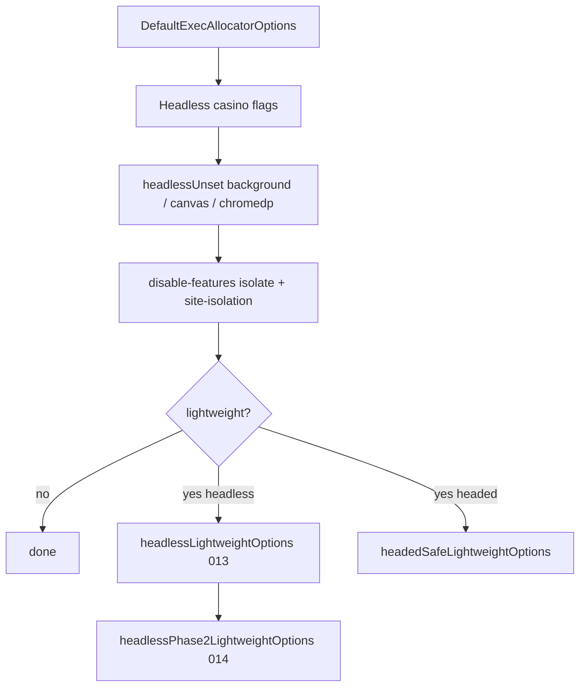

# Implementation Plan: Further Chrome RAM Reduction (Phase 2)

**Branch**: `014-optimizing-browsers-2` | **Date**: 2026-11-23 | **Spec**: [spec.md](./spec.md)

**Input**: Spec 014 + operator phase-2 Chrome flag list (plan message) + 013 baseline. **Filter rules**: skip flags already applied in 013 lightweight bundle or chromedp defaults; **do not** add flags that contradict bug fix [try-limit-of-app-config-exceeded-4](../../../.specify/bugs/try-limit-of-app-config-exceeded-4/fix.md) (headless must keep networking/UA/safebrowsing unset policy).

## Summary

Add **`headlessPhase2LightweightOptions()`** appended after existing **`headlessLightweightOptions()`** (013) when `headless && lightweight`. Phase-2 tightens caches and V8 heap and adds safe `disable-*` flags. **Replace** (not duplicate) `disk-cache-size` and `js-flags` values. Preserve all `headlessUnset*` blocks and Spribe/WebGL obligations. No CLI/registry changes. Document 013 vs 014 median MiB in research **Baseline Record (014)**.

## Technical Context

**Language/Version**: Go 1.27.1 (`go.mod`)

**Primary Dependencies**: `chromedp` v0.23 (unchanged)

**Storage**: No change (reuse 013 registry; `lightweight` still drives tiers)

**Testing**: Extend `internal/browser/chromedp_test.go`; rerun `go test ./...` + `OneWin|Aviator` stand-ins; optional `TestPhase2FlagsPresent` integration smoke

**Target Platform**: Linux / WSL2

**Project Type**: CLI — `internal/browser/chromedp.go`, `headless-chrome-flags.txt`

**Performance Goals**: SC-001 — ≥15% lower idle median MiB vs **013** profile on same host

**Constraints**: No `disable-gpu` / `disable-software-rasterizer`; no hard memory caps; bug **-4** unset flags must remain unset

**Scale/Scope**: ~80–150 LOC in `chromedp.go` + tests + flag doc; no new packages

## Constitution Check

| Principle | Status | Notes |
|-----------|--------|-------|
| I. Spec Before Implementation | Pass | Spec 014 + this plan |
| II. CLI as Operator Interface | Pass | No new commands; help note optional (FR-007) |
| III. Multiple Browser Instances | Pass | Per-instance allocator unchanged |
| IV. Supervisor Owns the Run | Pass | Worker still reads registry `lightweight` |
| V. Named Casinos / Games | Pass | Stand-in gate before aggressive V8 step |
| Technical: chromedp | Pass | |
| Delivery: tests | Pass | Default suite + Aviator stand-ins |

**Gate result**: Pass.

**Post–Phase 1 re-check**: Pass. Contracts amend 013 allocator only; data model unchanged.

## Project Structure

### Documentation (this feature)

```text
specs/014-optimizing-browsers-2/
├── plan.md
├── spec.md
├── research.md
├── data-model.md
├── quickstart.md
├── contracts/
│   ├── browser-allocator-phase2.md
│   └── operator-memory-limits.md
└── tasks.md             # /speckit-tasks
```

### Source Code

```text
internal/browser/chromedp.go       # headlessPhase2LightweightOptions(); merge/replace flags
headless-chrome-flags.txt          # SPEC 014 section
internal/browser/chromedp_test.go  # phase-2 presence + guardrail negatives
```

**Structure Decision**: Single Go module; phase-2 is a second slice in the headless lightweight path only.

## Design

### Allocator order (unchanged through 013)



### Flag filtering (plan input)

1. **Skip — already in 013 bundle** (do not add again): see [research.md](./research.md) §R2 “013 already present”.
2. **Skip — already effective via chromedp defaults** (e.g. `disable-extensions`, `disable-sync`): no duplicate `Flag(..., true)`.
3. **Forbidden — bug -4 / Spribe guardrails** (must **not** pass; keep unset `false` where applicable): `disable-background-networking`, `disable-background-timer-throttling`, `disable-backgrounding-occluded-windows`, `disable-renderer-backgrounding`, `disable-remote-fonts`, `disable-reading-from-canvas`, `safebrowsing-disable-auto-update`, `enable-features` (Puppeteer NetworkService pair), forced desktop UA removal.
4. **Forbidden — 013 permanent rejects**: `disable-gpu`, `disable-software-rasterizer`, full `js-flags` bundle with `expose-gc`, etc.

### Implementation phases

**Phase A — Research lock** (pre-code)

- Finalize adopt/reject in `research.md` R3–R5.
- Record 013 median from `specs/013-optimizing-browsers/research.md` Baseline Record on reference host.

**Phase B — Code**

1. Add `headlessPhase2LightweightOptions()`; append after 013 slice in `AllocatorOptions`.
2. **Replace** `disk-cache-size` in 013 slice **or** override in phase-2 via single merged definition (avoid duplicate Chrome args — implementation uses one winning value per name).
3. **Replace** `js-flags` `--max-old-space-size=384` → `320` only after stand-in pass (research R4).
4. Extend or merge `disable-features` string without dropping `IsolateOrigins,site-per-process` or re-adding `enable-features`.

**Phase C — Verification**

- Unit: phase-2 flags present; forbidden flags absent; unset block still contains bug -4 entries.
- Integration: `OneWin|Aviator`; SC-005 style five-headless unchanged.
- Manual: Baseline Record (014) pre/post 013 vs 014 medians.

## Complexity Tracking

| Item | Why Needed | Simpler Alternative Rejected Because |
|------|------------|-------------------------------------|
| Second options slice | Clear 013 vs 014 diff for tests and rollback | Editing 013 list in place hides regression baseline |
| `js-flags` step-down | Main remaining lever from deferred operator list | 250 MiB fails stand-ins without proof |

## Artifacts generated (Phase 0–1)

| Artifact | Path |
|----------|------|
| Research | [research.md](./research.md) |
| Data model | [data-model.md](./data-model.md) |
| Allocator contract | [contracts/browser-allocator-phase2.md](./contracts/browser-allocator-phase2.md) |
| Operator limits doc | [contracts/operator-memory-limits.md](./contracts/operator-memory-limits.md) |
| Quickstart | [quickstart.md](./quickstart.md) |

## Next step

Run **`/speckit-tasks`**, then implement Phase B after T009 records 013 baseline on host.