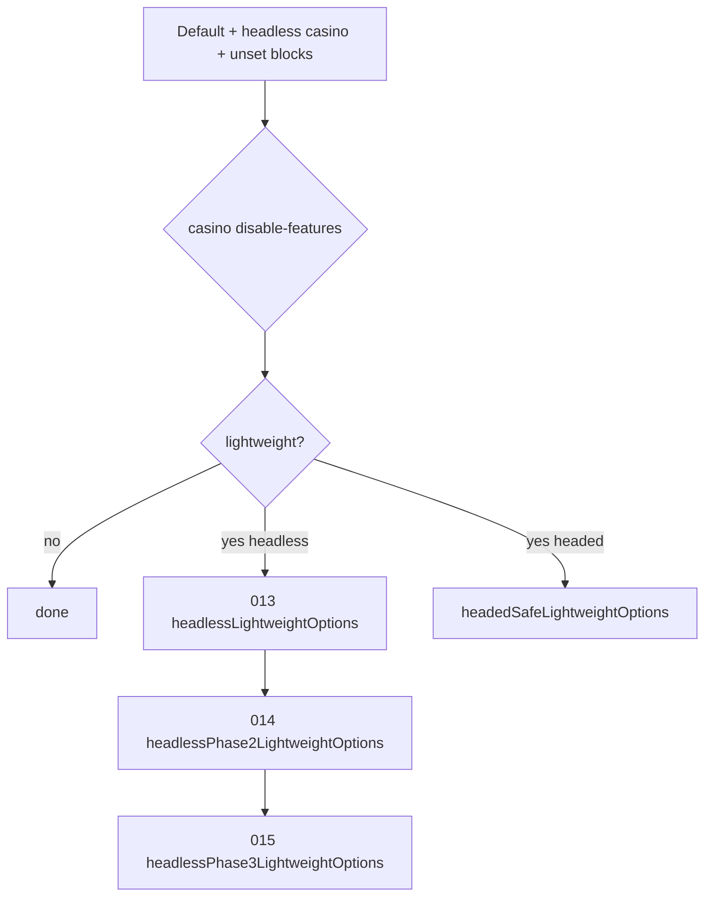

# Implementation Plan: Aggressive Chrome RAM Reduction (Phase 3)

**Branch**: `015-optimizing-browsers-3` | **Date**: 2026-11-23 | **Spec**: [spec.md](./spec.md)

**Input**: Operator phase-3 Chrome flag list (spec input) on top of **013 + 014** profile. **Note**: `/speckit-plan` was invoked with `slug=optimizing-browsers-4`; active feature directory is **`015-optimizing-browsers-3`** per `.specify/feature.json`.

## Summary

Evaluate the operator’s aggressive flag list in [research.md](./research.md) §R2; append **`headlessPhase3LightweightOptions()`** only for **adopt**ed, non-duplicate switches when `headless && lightweight`. Expected net-new adopt: **`memory-pressure-off`** (if Chrome accepts on target build). **Reject** GPU/WebGL/3D disables, **`disable-background-networking`**, **`single-process`**, and the full **`js-flags`** bundle; keep **`enable-webgl`** + **`use-angle=swiftshader`**. No CLI/registry changes. Baseline **014 vs 015** in research **Baseline Record (015)**.

## Technical Context

**Language/Version**: Go 1.27.1 (`go.mod`)

**Primary Dependencies**: chromedp v0.23 (unchanged)

**Storage**: No change (013 registry; `lightweight` tier)

**Testing**: Extend `internal/browser/chromedp_test.go`; `go test ./...`; `OneWin|Aviator` after any adopt

**Target Platform**: Linux / WSL2

**Project Type**: CLI — `internal/browser/chromedp.go`, `headless-chrome-flags.txt`

**Performance Goals**: SC-001 — ≥15% idle median MiB vs **014** on same host, **or** documented reject-all outcome per spec SC-001 alt

**Constraints**: Bug **-4** unset policy; no contradicting `enable-webgl`; FR-005 rejects experimental process/V8 bundle on default profile

**Scale/Scope**: Small slice (0–3 flags likely); matrix + tests + docs

## Constitution Check

| Principle | Status | Notes |
|-----------|--------|-------|
| I. Spec Before Implementation | Pass | Spec 015 + this plan |
| II. CLI as Operator Interface | Pass | No new commands |
| III. Multiple Browser Instances | Pass | Per-instance allocator |
| IV. Supervisor Owns the Run | Pass | Unchanged |
| V. Named Casinos / Games | Pass | Stand-in gate before any adopt |
| Technical: chromedp | Pass | |
| Delivery: tests | Pass | FR-008 |

**Gate result**: Pass.

**Post–Phase 1 re-check**: Pass.

## Project Structure

### Documentation (this feature)

```text
specs/015-optimizing-browsers-3/
├── plan.md
├── spec.md
├── research.md
├── data-model.md
├── quickstart.md
├── contracts/
│   ├── browser-allocator-phase3.md
│   └── operator-flag-matrix.md
└── tasks.md             # /speckit-tasks
```

### Source Code

```text
internal/browser/chromedp.go       # headlessPhase3LightweightOptions()
headless-chrome-flags.txt          # SPEC 015 section
internal/browser/chromedp_test.go  # phase-3 + guardrail tests
```

**Structure Decision**: Third slice after `headlessPhase2LightweightOptions()` when `headless && lightweight`.

## Design

### Allocator order



### Operator list → plan disposition (pre-research lock in research.md)

| Proposal | Disposition |
|------------|-------------|
| `process-per-site`, `disable-application-cache`, `v8-cache-options=none` | **Skip** (013) |
| `disable-gpu`, `disable-webgl`, `disable-3d-apis` | **Reject** (FR-004; conflicts with `enable-webgl` + SwiftShader) |
| `disable-background-networking` | **Reject** (FR-003; bug **-4**) |
| `single-process` | **Reject** (FR-005) |
| `js-flags` bundle (128 + expose-gc + …) | **Reject** on default profile (FR-005); optional gated experiment in research only |
| `memory-pressure-off` | **Adopt candidate** (only net-new safe switch) |

### Implementation phases

**Phase A** — Lock matrix in `research.md` R2–R4 after Chrome flag smoke on reference binary.

**Phase B** — If ≥1 adopt: add `headlessPhase3LightweightOptions()`, tests, `headless-chrome-flags.txt` §015.

**Phase C** — Baseline Record (015) vs 014 median **~1122 MiB** (shipped 014); stand-ins.

## Complexity Tracking

| Item | Why Needed | Simpler Alternative Rejected Because |
|------|------------|-------------------------------------|
| Third options slice | Traceable 014 vs 015 diff | Editing phase-2 in place hides rollback |
| Reject GPU/WebGL list | Operator asked; spec forbids default ship | Blind adopt breaks Aviator |

## Artifacts generated (Phase 0–1)

| Artifact | Path |
|----------|------|
| Research | [research.md](./research.md) |
| Data model | [data-model.md](./data-model.md) |
| Allocator contract | [contracts/browser-allocator-phase3.md](./contracts/browser-allocator-phase3.md) |
| Flag matrix | [contracts/operator-flag-matrix.md](./contracts/operator-flag-matrix.md) |
| Quickstart | [quickstart.md](./quickstart.md) |

## Next step

Run **`/speckit-tasks`**, then implement only **adopt** rows from the matrix.