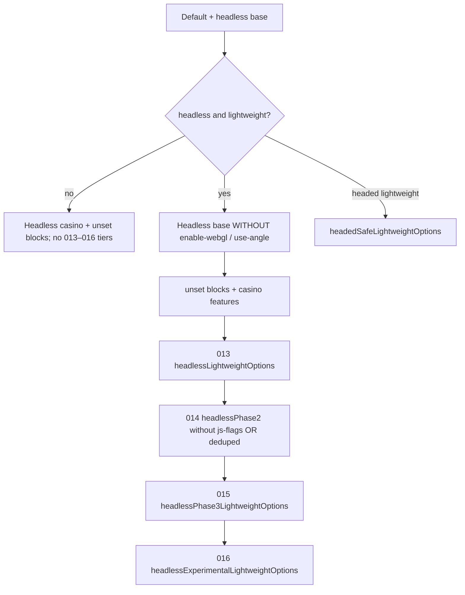

# Implementation Plan: Aggressive RAM Experiment (Default Headless)

**Branch**: `016-optimizing-browsers-experimental` | **Date**: 2026-11-24 | **Spec**: [spec.md](./spec.md)

**Input**: Experiment flag set on default `start --headless` (lightweight on); performance-neutral `--no-lightweight`; no new CLI flag. Slug: `optimizing-browsers-experimental`.

## Summary

Add **`headlessExperimentalLightweightOptions()`** (six switches from spec Input) applied when `headless && lightweight` **after** 013/014/015 slices. **Omit** `enable-webgl` and `use-angle=swiftshader` from the headless base when lightweight is on so the experiment GPU/WebGL disables are not contradicted. **Single** effective `js-flags`: experimental **128** bundle wins over phase-2 **320** (implement by not appending phase-2 `js-flags` when experimental slice is active, or equivalent dedupe). **`--no-lightweight`** skips 013/014/015 **and** experimental (minimal headless per **FR-001**). Update `headless-chrome-flags.txt`, `start` help, allocator tests, baseline **015 vs 016** in [research.md](./research.md), stand-in gate. Rollback task if stand-ins fail.

## Technical Context

**Language/Version**: Go 1.27.1 (`go.mod`)

**Primary Dependencies**: chromedp v0.23 (unchanged)

**Storage**: No registry/CLI schema changes (**FR-004**, **FR-005**)

**Testing**: `internal/browser/chromedp_test.go`; `go test ./...`; `OneWin|Aviator` on default headless after change (**FR-007**)

**Target Platform**: Linux / WSL2

**Project Type**: CLI — `internal/browser/chromedp.go`, `internal/cli/start.go`, `headless-chrome-flags.txt`

**Performance Goals**: SC-003 — record **median_016_default_mib** vs **median_015_mib**; target **≥10%** idle reduction per spec US2 (document if not met)

**Constraints**: No `disable-background-networking` in experiment; bug **-4** unset blocks unchanged on all headless paths; no new experimental CLI/registry flag

**Scale/Scope**: One allocator slice + conditional headless WebGL + js-flags dedupe + docs/help/tests/baseline

## Constitution Check

| Principle | Status | Notes |
|-----------|--------|-------|
| I. Spec Before Implementation | Pass | Spec 016 + this plan |
| II. CLI as Operator Interface | Pass | Help text only; no new commands |
| III. Multiple Browser Instances | Pass | Per-instance allocator |
| IV. Supervisor Owns the Run | Pass | Unchanged |
| V. Named Casinos / Games | **Conditional** | Default headless may break stand-ins until proven; **FR-007** + rollback in research R5 |
| Technical: chromedp | Pass | |
| Delivery: tests | Pass | FR-007, SC-005 |

**Gate result**: Pass with **V** gated on stand-in results before calling feature complete.

**Post–Phase 1 re-check**: Pass.

## Project Structure

### Documentation (this feature)

```text
specs/016-optimizing-browsers-experimental/
├── plan.md
├── spec.md
├── research.md
├── data-model.md
├── quickstart.md
├── contracts/
│   ├── browser-allocator-experimental.md
│   └── no-lightweight-neutral.md
└── tasks.md             # /speckit-tasks
```

### Source Code

```text
internal/browser/chromedp.go       # headlessExperimentalLightweightOptions(), AllocatorOptions branch
headless-chrome-flags.txt          # SPEC 016 section
internal/browser/chromedp_test.go  # experimental + no-lightweight neutral tests
internal/cli/start.go              # Long help (FR-008)
lightweight-profile-flags.txt      # regenerate / update after implement
```

**Structure Decision**: Fourth lightweight slice when `headless && lightweight`, after phase 3.

## Design

### Allocator order (post-016)



### Experiment flag set (locked)

Per [spec.md](./spec.md) Input: `disable-gpu`, `disable-webgl`, `disable-3d-apis`, `disable-software-rasterizer`, `single-process`, `js-flags=--max-old-space-size=128 --expose-gc --optimize-for-size --flush-bytecode --gc-global`.

### `--no-lightweight`

When `!lightweight`: do not append 013/014/015/016; headless keeps Spribe-safe unset policy; **no** performance/RAM tuning flags (**[contracts/no-lightweight-neutral.md](./contracts/no-lightweight-neutral.md)**).

### Implementation phases

**Phase A** — Lock merge rules in [research.md](./research.md) (R1–R3).

**Phase B** — Implement slice + tests + flags doc + help.

**Phase C** — Baseline + stand-ins; rollback branch documented in R5 if needed.

## Complexity Tracking

| Item | Why Needed | Simpler Alternative Rejected Because |
|------|------------|-------------------------------------|
| Default profile behavior change | Spec FR-003: experiment on default headless without new flag | Opt-in flag rejected by operator |
| Conditional headless WebGL | Spec Input disables WebGL/GPU | Blind append breaks experiment semantics |
| js-flags dedupe | Two heap targets (320 vs 128) | Duplicate `js-flags` on argv is invalid |

## Artifacts generated (Phase 0–1)

| Artifact | Path |
|----------|------|
| Research | [research.md](./research.md) |
| Data model | [data-model.md](./data-model.md) |
| Allocator contract | [contracts/browser-allocator-experimental.md](./contracts/browser-allocator-experimental.md) |
| No-lightweight contract | [contracts/no-lightweight-neutral.md](./contracts/no-lightweight-neutral.md) |
| Quickstart | [quickstart.md](./quickstart.md) |

## Next step

Run **`/speckit-tasks`**, then implement per contracts and research R1–R3.