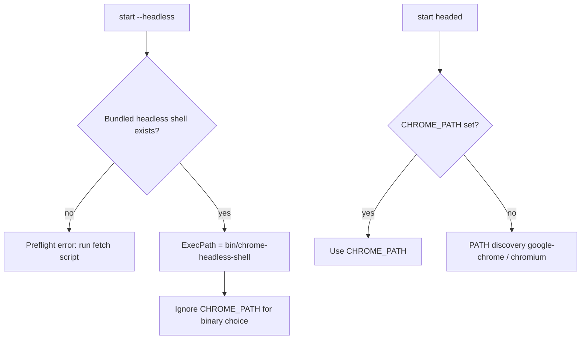
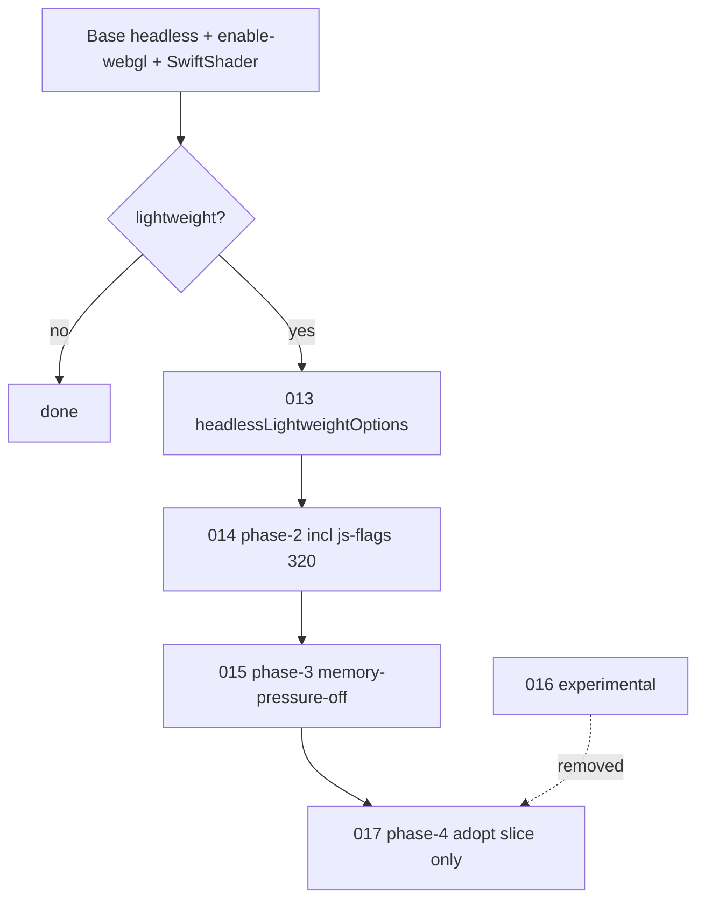

# Implementation Plan: Headless Shell and Performance Flags (Phase 4)

**Branch**: `017-optimizing-browsers-4` | **Date**: 2026-11-24 | **Spec**: [spec.md](./spec.md)

**Input**: `chrome-performance-flags.txt`, **015** baseline, project **chrome-headless-shell**, ephemeral profiles, headless ignores `CHROME_PATH` for full Chrome.

## Summary

Deliver four coupled changes on the default headless path:

1. **Revert** spec **016** experimental slice; restore **015** allocator (WebGL + SwiftShader, `memory-pressure-off`, no GPU/WebGL/128-js experiment).
2. **Bundle** `chrome-headless-shell` via repo script into a gitignored `bin/` artifact; headless `start` **always** uses it (**FR-006**, **FR-007**).
3. **Evaluate** `chrome-performance-flags.txt` per **015** discipline; append **`headlessPhase4LightweightOptions()`** only for **adopt** switches when `headless && lightweight`.
4. **Harden** ephemeral profile lifecycle with integration tests (**FR-012**–**FR-013**, **SC-006**–**SC-007**); worker/stop/reconcile paths already call `RemoveProfile`.

Baseline: **median_015_mib** vs **median_017_mib** (10% bar per spec **SC-001**).

## Technical Context

**Language/Version**: Go 1.27.1 (`go.mod`)

**Primary Dependencies**: chromedp v0.23; **chrome-headless-shell** (Chrome for Testing distribution, pinned in [research.md](./research.md))

**Storage**: Ephemeral per-instance profile under `XDG_DATA_HOME/.../profiles/<id>`; deleted on teardown. Headless shell binary under `bin/chrome-headless-shell` (gitignored, provisioned by script).

**Testing**: `internal/browser/chromedp_test.go` (allocator + binary selection); new integration test for profile removal; `go test ./...`; stand-ins `OneWin|Aviator` after adopt + shell switch

**Target Platform**: Linux / WSL2 (amd64 first; plan documents gap for other GOARCH)

**Project Type**: CLI — `internal/browser/`, `internal/cli/start.go`, `internal/worker/run.go`, `scripts/fetch-chrome-headless-shell.sh`

**Performance Goals**: **SC-001** — ≥10% idle median MiB vs **015** on same host, or documented reject outcome

**Constraints**: No `disable-background-networking=true` on headless; headless ignores `CHROME_PATH` for full Chrome; constitution default tests without live casino

**Scale/Scope**: Medium — binary provisioning, `Executable()` split, remove 016 slice, phase-4 flags, profile tests, docs

## Constitution Check

| Principle | Status | Notes |
|-----------|--------|-------|
| I. Spec Before Implementation | Pass | Spec 017 + this plan |
| II. CLI as Operator Interface | Pass | `start`/`stop`; help text updates |
| III. Multiple Browser Instances | Pass | Isolated profile + shell per instance |
| IV. Supervisor Owns the Run | Pass | Profile deleted when run ends |
| V. Named Casinos / Games | Pass | Stand-ins gate adoptions + shell |
| Technical: chromedp | Pass | Same control stack; different headless binary |
| Delivery: tests | Pass | SC-004, SC-006, SC-007 |

**Gate result**: Pass.

**Post–Phase 1 re-check**: Pass (contracts + research lock decisions).

## Project Structure

### Documentation (this feature)

```text
specs/017-optimizing-browsers-4/
├── plan.md
├── spec.md
├── research.md
├── data-model.md
├── quickstart.md
├── contracts/
│   ├── browser-allocator-phase4.md
│   ├── headless-shell-binary.md
│   ├── ephemeral-profile.md
│   └── operator-flag-matrix.md
└── tasks.md             # /speckit-tasks
```

### Source Code

```text
internal/browser/chromedp.go       # Remove 016 slice; phase-4 allocator
internal/browser/executable.go   # HeadlessShellPath + headed Executable (required)
internal/browser/executable_test.go
internal/browser/chromedp_test.go
internal/cli/start.go            # preflight + help (headless shell, CHROME_PATH rule)
scripts/fetch-chrome-headless-shell.sh
bin/chrome-headless-shell        # gitignored artifact
.gitignore                       # bin/chrome-headless-shell, download cache if any
headless-chrome-flags.txt
lightweight-profile-flags.txt
tests/integration/               # profile_ephemeral_test.go, start binary smoke
```

**Structure Decision**: Single Go module; shell fetch is bash script invoked from quickstart/Makefile target (plan does not add Makefile unless tasks choose).

## Design

### Headless binary resolution



### Allocator order (post-017)



### Implementation phases

**Phase A** — Provision headless shell pin; smoke `chromedp` with bundled binary; lock adopt/reject matrix in [research.md](./research.md) R2 after argv smoke.

**Phase B** — Remove `headlessExperimentalLightweightOptions`; implement `HeadlessShellExecutable()` + start preflight; headed `Executable()` unchanged.

**Phase C** — `headlessPhase4LightweightOptions()` + unit tests + flag docs.

**Phase D** — Ephemeral profile integration tests; baseline + stand-ins; quickstart validation.

## Complexity Tracking

| Item | Why Needed | Simpler Alternative Rejected Because |
|------|------------|-------------------------------------|
| Bundled headless shell | Spec FR-005/006; RAM footprint | Full Chrome on headless missed operator goal |
| Ignore `CHROME_PATH` on headless | Spec FR-007 | Operators already set CHROME_PATH for headed; accidental full Chrome on headless breaks experiment |
| Revert 016 before phase-4 | Spec FR-011; 015 “successful” | Layering on 016 GPU-off baseline confounds RAM and games |
| Fourth allocator slice | Traceable rollback vs editing 015 | Single blob hides what changed |

## Artifacts generated (Phase 0–1)

| Artifact | Path |
|----------|------|
| Research | [research.md](./research.md) |
| Data model | [data-model.md](./data-model.md) |
| Quickstart | [quickstart.md](./quickstart.md) |
| Phase-4 allocator | [contracts/browser-allocator-phase4.md](./contracts/browser-allocator-phase4.md) |
| Headless shell | [contracts/headless-shell-binary.md](./contracts/headless-shell-binary.md) |
| Ephemeral profile | [contracts/ephemeral-profile.md](./contracts/ephemeral-profile.md) |
| Flag matrix | [contracts/operator-flag-matrix.md](./contracts/operator-flag-matrix.md) |