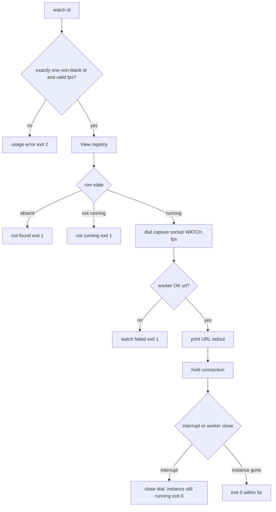

# Implementation Plan: Instance Watch (Local Live View)

**Branch**: `018-instance-watch` | **Feature directory**: `specs/018-instance-watch` | **Date**: 2026-11-25 | **Spec**: [spec.md](./spec.md)

**Input**: Feature specification from `specs/018-instance-watch/spec.md` (assessment slug `real-time-streaming`)

## Summary

Add `supervisor watch <instance-id>` so an operator can open a loopback URL and see a live multipart JPEG view of one running instance. The detached worker that already owns the chromedp tab starts `Page.startScreencast`, throttles frames to `--fps` (default **1**, max **30**), and serves `multipart/x-mixed-replace` on `127.0.0.1` starting at port **8080** (next free port if busy). The CLI reaches that worker on the existing per-instance Unix socket with a `WATCH` line, prints the URL the worker returns, and stays attached until interrupt or the worker closes the connection because the instance stopped (FR-001, FR-004, FR-010, FR-011, FR-014). `screenshot` keeps using `CAPTURE` on the same socket and the same capture mutex so a still PNG can be taken while a watch is active (FR-012). One watch per instance (FR-013). No registry schema change. `start`, `status`, `stop`, and `logs` stay as they are.

## Technical Context

**Language/Version**: Go 1.27.1 (`go.mod`, constitution)

**Primary Dependencies**: `github.com/chromedp/chromedp` v0.23.0 and `github.com/chromedp/cdproto` (`page.StartScreencast`, `page.ScreencastFrameAck`, existing `CaptureScreenshot`); `github.com/spf13/cobra` v1.10.2 (`watch`, `--fps`)

**Storage**: Unchanged JSON registry (`internal/registry`, schema version 1). The live view is not a file and not a registry field. The capture socket path stays `{state}/sockets/<id>.sock`.

**Testing**: `go test ./...`. Unit tests for `--fps` parsing, port-fallback selection, and the `WATCH` line protocol without Chrome. Integration tests under `tests/integration/` with headless Chrome, skipped when Chrome is absent (`requireChrome`): start watch, read the multipart stream, interrupt, stop-while-watching, refuse unknown IDs, and screenshot during watch. A headed window is a manual quickstart check. Default tests do not open a live casino site. Optional soak stays behind `//go:build slow`.

**Target Platform**: Linux and WSL2 (constitution, spec edge case)

**Project Type**: CLI binary `cmd/supervisor`

**Performance Goals**: URL printed and first JPEG boundary within 10 seconds (SC-001). Watch exits within 5 seconds after the instance leaves `running` (FR-010, SC-003). Default cadence about 1 update/s on a changing stand-in page (SC-006). Per-frame chromedp work stays inside the existing 10-second child timeout used by screenshot.

**Constraints**: Loopback only. No second browser tab. Do not cancel the browser context from the watch path. Do not bump `schema_version`. Do not redact page pixels. At most one watch per instance. Do not replace `screenshot`.

**Scale/Scope**: One new operator command. One HTTP listener per active watch, owned by that instance's worker, torn down when the CLI disconnects or the worker shuts down. Multiple instances may be watched from separate terminals, each on its own port.

## Constitution Check

*GATE: Must pass before Phase 0 research. Re-check after Phase 1 design.*

| Principle | Status | Notes |
|-----------|--------|-------|
| I. Spec Before Implementation | Pass | Spec `018-instance-watch` drives this plan |
| II. CLI as the Operator Interface | Pass | Observation is `watch`; the browser is only the viewer of the URL the CLI prints |
| III. Multiple Browser Instances | Pass | Each watch uses that instance's worker and tab. Ports are per process, not a shared browser |
| IV. Supervisor Owns the Run | Pass | Interrupt ends the stream and leaves the instance running. `stop` still owns teardown; watch follows |
| V. Named Casinos and Games Only | Pass | No casino or game selection |

Technical constraints: module path, Go 1.27.1, and chromedp stay as ratified. Stream bytes are runtime output and are not committed. Default tests do not hit a live casino site.

**Post–Phase 1 re-check**: Pass. [research.md](./research.md) keeps screencast on the worker tab and HTTP on loopback. [data-model.md](./data-model.md) adds no registry fields. [contracts/cli.md](./contracts/cli.md) is the operator delta. [contracts/watch-socket.md](./contracts/watch-socket.md) extends the internal socket only.

## Project Structure

### Documentation (this feature)

```text
specs/018-instance-watch/
├── plan.md
├── research.md
├── data-model.md
├── quickstart.md
├── contracts/
│   ├── cli.md
│   └── watch-socket.md
└── tasks.md
```

### Source Code (repository root)

```text
internal/cli/
├── root.go            # register watch; usage strings for --fps
└── watch.go           # args, lookup, dial, print URL, wait

internal/worker/
├── run.go             # stop watch listener with capture on shutdown
├── capture.go         # existing CAPTURE path unchanged in contract
└── watch.go           # WATCH line, screencast, MJPEG, port bind

tests/unit/
├── watch_fps_test.go
└── watch_port_test.go

tests/integration/
├── watch_test.go
├── watch_refuse_test.go
└── watch_screenshot_test.go
```

**Structure Decision**: Keep the single-module layout from 001 and the socket from 003. The worker gains a second request verb on the same socket; the CLI gains one long-running command. No new module and no registry schema change.

## Design

### Command flow



### Worker

- Serve `WATCH <fps>` on the existing capture socket, one request per connection, same as `CAPTURE`.
- If a watch is already active for this worker, reply `ERR already watching` and do not start a second listener.
- Bind `127.0.0.1` from port 8080 upward until `Listen` succeeds. Reply `OK http://127.0.0.1:<port>/\n` and keep the Unix connection open.
- Start `page.StartScreencast` (JPEG) on the existing tab context. Acknowledge each `screencastFrame` in a separate goroutine so the listener is not blocked.
- Publish to the HTTP handler at most `--fps` JPEGs per second (drop or replace older frames). Static headless pages may emit fewer frames; that is success.
- `CaptureScreenshot` stays behind the existing mutex and 10-second child context. Do not hold that mutex across the screencast event loop.
- When the Unix client disconnects, call `page.StopScreencast`, close the HTTP listener, and clear the "watching" flag. Do not cancel `taskCtx`.
- When `taskCtx` ends, close the Unix connection and the HTTP listener before the existing registry remove.

### Exit codes (delta)

| Outcome | Code | Stream |
|---------|------|--------|
| URL printed, then interrupt or instance ended | 0 | URL only, stdout |
| Missing, extra, or blank ID; invalid `--fps`; bad flags | 2 | stderr, usage |
| Not found, not running, watch failed, second watch | 1 | stderr |

## Phase 0 / Phase 1 Artifacts

| Artifact | Path |
|----------|------|
| Research decisions | [research.md](./research.md) |
| Data model | [data-model.md](./data-model.md) |
| Operator contract | [contracts/cli.md](./contracts/cli.md) |
| Worker socket contract | [contracts/watch-socket.md](./contracts/watch-socket.md) |
| Validation guide | [quickstart.md](./quickstart.md) |

## Complexity Tracking

No constitution violations. Table omitted.
