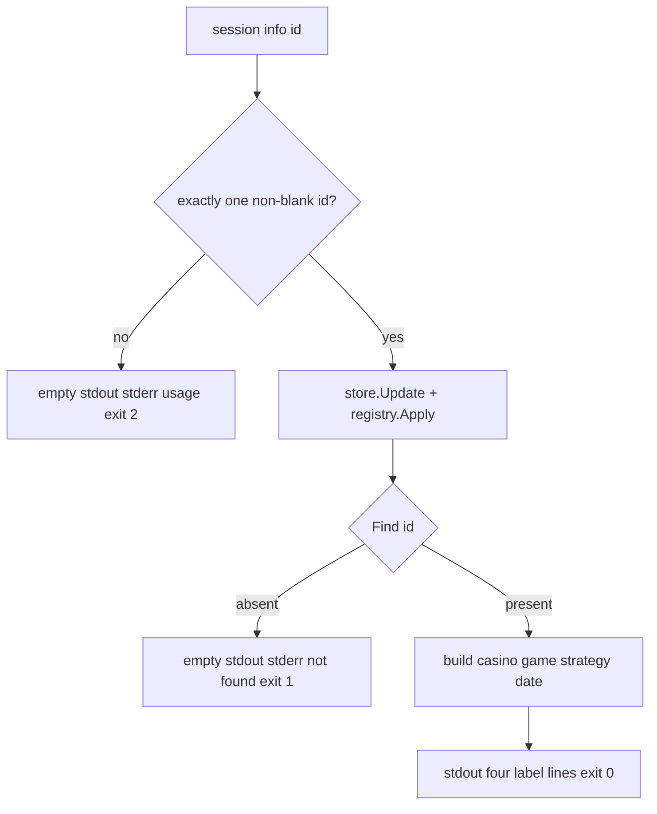

# Implementation Plan: Session Instance Info

**Branch**: `019-session-data` | **Feature directory**: `specs/019-session-data` | **Date**: 2026-11-26 | **Spec**: [spec.md](./spec.md)

**Input**: Feature specification from `specs/019-session-data/spec.md` (slug `session-data`)

## Summary

Add **`supervisor session info <instance-id>`**: a read-only operator command that prints four plain-text lines (`casino`, `game`, `strategy`, `date`) for one registry row after reconciliation. Values come from the existing `Instance.Casino` and `CreatedAt` fields; `game` is resolved through `internal/casino.Lookup` when a casino is set (today `onewin` → `aviator`); `strategy` is always the literal `null`; `date` is UTC `YYYY-MM-DD HH:MM`. Success data on stdout only (stderr empty); every failure leaves stdout empty and writes errors to stderr (FR-005b). No JSON, no new registry fields, no worker changes. Register a top-level `session` command with subcommand `info`; list `session` in root help. Integration tests follow screenshot/watch patterns including empty stdout on refusal paths.

## Technical Context

**Language/Version**: Go 1.27.1 (`go.mod`, constitution)

**Primary Dependencies**: `github.com/spf13/cobra` v1.10.2; `internal/registry`; `internal/casino` for registered game id when casino is known

**Storage**: Unchanged JSON registry (`internal/registry`, schema version 1). Session info is not persisted.

**Testing**: `go test ./...`. Unit tests for line formatting (`null` sentinels, `2006-01-02 15:04` UTC date, game from catalog). Integration tests in `tests/integration/session_info_test.go` and `session_info_help_test.go` with isolated `XDG` env; assert `len(stdout)==0` on usage and not-found (SC-004). Onewin stand-in reuses existing integration helpers. Default tests do not hit a live casino site.

**Target Platform**: Linux and WSL2 (constitution)

**Project Type**: CLI binary `cmd/supervisor`

**Performance Goals**: Single registry read + reconcile; output within the same class as one-shot `status` row lookup (sub-second, no long poll)

**Constraints**: No cookies, session paths, or profile dirs on stdout/stderr. No JSON. Exactly four success lines on stdout; stderr empty on success. Empty stdout on every non-zero exit (FR-005b). Reconcile with `registry.Apply` inside `store.Update` before lookup (FR-003). Success for any tracked lifecycle state (not limited to `running` — unlike `screenshot`/`watch`).

**Scale/Scope**: Two new CLI files or one parent + one child (~120 LOC). Optional small `formatSessionInfo` helper testable from `internal/cli` or `internal/sessioninfo` package if formatting grows; default is `internal/cli/session.go` + `session_info.go`.

## Constitution Check

*GATE: Must pass before Phase 0 research. Re-check after Phase 1 design.*

| Principle | Status | Notes |
|-----------|--------|-------|
| I. Spec Before Implementation | Pass | Spec `019-session-data` drives this plan |
| II. CLI as the Operator Interface | Pass | New operator `session info` |
| III. Multiple Browser Instances | Pass | Read-only per ID |
| IV. Supervisor Owns the Run | Pass | No lifecycle change |
| V. Named Casinos and Games Only | Pass | Game line uses registered ids from `casino.Lookup` only |
| Technical: Go, chromedp, secrets | Pass | No chromedp use; no secret fields in output |
| Delivery: CLI tests | Pass | FR-011 integration coverage in plan |

**Post–Phase 1 re-check**: Pass. [research.md](./research.md) (R5 date layout, R8 I/O). [data-model.md](./data-model.md) adds no registry fields. [contracts/cli.md](./contracts/cli.md) documents stdout/stderr matrix.

## Project Structure

### Documentation (this feature)

```text
specs/019-session-data/
├── plan.md
├── research.md
├── data-model.md
├── quickstart.md
├── contracts/
│   └── cli.md
└── tasks.md
```

### Source Code (repository root)

```text
internal/cli/
├── root.go              # register session; root help lists session
├── session.go           # parent session command (help only)
└── session_info.go        # reconcile, lookup, print four lines

internal/casino/
└── catalog.go             # unchanged; Game field used for display

tests/integration/
├── session_info_test.go
└── session_info_help_test.go

tests/unit/                # optional if format logic is extracted
└── session_info_format_test.go
```

**Structure Decision**: Same single-module layout as 001–018. No registry schema bump.

## Design

### Command flow



### Output grammar

```text
casino: <identifier|null>
game: <identifier|null>
strategy: null
date: <YYYY-MM-DD HH:MM UTC>
```

- Literal `null` (four ASCII letters) when casino or game is absent.
- `strategy` is always `null` in this feature.
- `date` uses `inst.CreatedAt.UTC().Format("2006-01-02 15:04")` (minute precision; spec amendment 2026-11-26).

### Game resolution

When `inst.Casino != ""`, call `casino.Lookup(inst.Casino)`. On success and non-empty `Game`, print that game id; otherwise print `game: null`. Blank start (`Casino` empty) → both `casino: null` and `game: null`. No inference from `Entry` alone without a casino (research R2).

### Lookup and errors

- **Usage (exit 2)**: Cobra `ExactArgs(1)` failures, blank ID after trim → `instance ID required` on stderr, stdout empty (existing `isUsageError` path + `Execute` stderr usage dump; confirm no Cobra stdout usage).
- **Not found (exit 1)**: After reconcile, row missing → return `fmt.Errorf("instance not found: %s", id)` so `main` prints stderr; stdout empty (match `screenshot`/`watch` tests).
- **Registry I/O (exit 1)**: `store.Update` error → `supervisor: …` on stderr from `main`; stdout empty.
- **Success (exit 0)**: Four `fmt.Fprintf`/`Printf` lines to stdout only; do not write stderr (FR-005, FR-005b).

### Help

- Root: add `session` to available commands (update `tests/integration/root_help_test.go`).
- `session --help`: points to `info`.
- `session info --help`: documents ID, four fields, example block from contract.

## Complexity Tracking

No constitution violations. No extra table entries required.